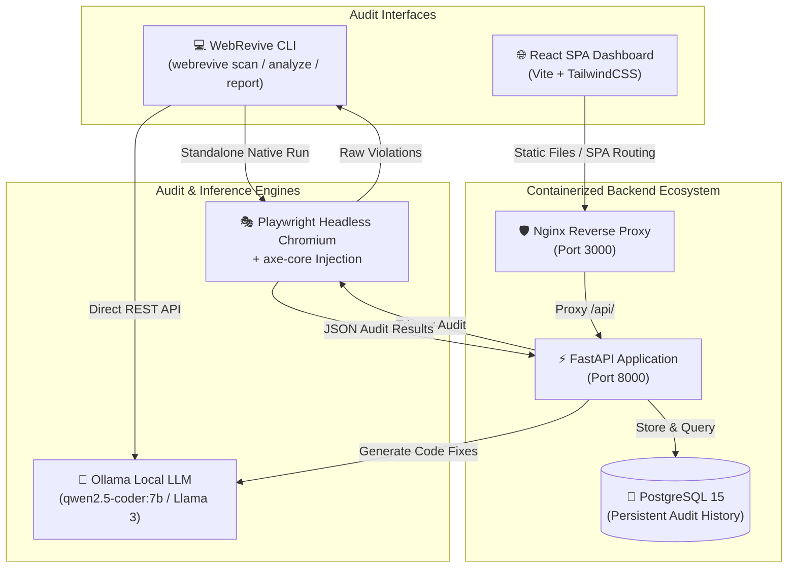

# WebRevive AI 🔍♿

[](https://github.com/webrevive-ai/webrevive/actions)
[](https://opensource.org/licenses/MIT)
[](https://www.python.org/)
[](https://nodejs.org/)
[-purple.svg)](https://www.w3.org/WAI/standards-guidelines/wcag/)
[-orange.svg)](https://ollama.ai)

> **Autonomous AI-based web accessibility auditing, WCAG 2.2 compliance validation, and intelligent frontend code refactoring engine powered by local LLMs.**

---

## 🌟 Key Features

- [x] **Headless Deep Scanning:** Integrates the industry standard `axe-core 4.9+` engine with Playwright headless browser automation to audit Single Page Applications (SPAs), dynamic DOM states, and authenticated views.
- [x] **100% Local-First AI Refactoring:** Harnesses local Ollama LLMs (`qwen2.5-coder:7b`, `llama3`, `mistral`) to diagnose accessibility barriers and autonomously write production-ready, refactored HTML, CSS, and ARIA code.
- [x] **Comprehensive WCAG 2.0 / 2.1 / 2.2 Coverage:** Detects contrast violations, missing alt text, incorrect ARIA roles, keyboard traps, focus ordering problems, landmark deficiencies, and form label errors across Levels A, AA, and AAA.
- [x] **Standalone High-Performance CLI:** Works immediately out of the box as a single command-line tool with color-coded severity tables, progress indicators, and instant file export.
- [x] **Multi-Format Export Engine:** Automatically generates publication-ready interactive HTML dashboards with embedded dark/light styling, GitHub-flavored Markdown compliance reports, and structured JSON.
- [x] **Production-Grade Microservices Architecture:** Includes Docker Compose configurations for FastAPI backend services, React SPA frontend with Nginx reverse proxy, PostgreSQL persistence, and Ollama model server.
- [x] **Enterprise Privacy & Security:** Zero cloud telemetry. No source code, DOM trees, or proprietary audit data ever leaves your local network.

---

## 🏗️ Architecture Overview

WebRevive AI operates both as a standalone CLI tool and as a full-stack web application:



---

## 📸 Screenshots & Previews

### CLI Rich Interactive Terminal Output
```text
┌────────────────────────────────────────────────────────────────────────────────────────┐
│ 🔍 WebRevive AI - Accessibility Scan Summary                                          │
│ URL: https://acme-store.com/checkout                                                  │
│ Title: Acme Checkout & Payment Portal                                                  │
│ Audited At: 2026-11-09T11:45:00Z                                                       │
│ Health Score: 68/100 | Critical: 2 | Serious: 3 | Moderate: 5 | Minor: 1 | Passed: 42   │
└────────────────────────────────────────────────────────────────────────────────────────┘

Detected Accessibility Violations ( displaying 2 of 11 )
┌──────────┬────────────────────────┬──────────────────────────────────────────┬──────────────────────────────────────────┐
│ Severity │ Rule ID & Guidelines   │ Description & Help                       │ Failing Selector & Element               │
├──────────┼────────────────────────┼──────────────────────────────────────────┼──────────────────────────────────────────┤
│ CRITICAL │ image-alt              │ Images must have alternate text          │ form > div.payment-icon > img            │
│          │ wcag2a, wcag111        │ Ensures  elements have alt text or  │               │
│          │                        │ role="presentation"                      │ + 1 more occurrence(s)                   │
├──────────┼────────────────────────┼──────────────────────────────────────────┼──────────────────────────────────────────┤
│ SERIOUS  │ color-contrast         │ Elements must meet minimum contrast      │ button#place-order                       │
│          │ wcag2aa, wcag143       │ Insufficient color contrast of 2.4:1     │ <button class="btn-primary">Pay</button> │
│          │                        │ Required minimum threshold is 4.5:1      │                                          │
└──────────┴────────────────────────┴──────────────────────────────────────────┴──────────────────────────────────────────┘
```

### Self-Contained HTML Audit Report
Generated reports feature:
- Dynamic Accessibility Health Score gauge (0–100)
- Impact badge counters (Critical, Serious, Moderate, Minor)
- Collapsible DOM node diagnostics with highlighted code snippets
- Deep links to Deque University & W3C WCAG criteria documentation
- Zero external CSS/JS dependencies (fully portable & printable)

---

## ⚡ Quick Start

### 1. Prerequisites

Ensure your development machine has the following tools installed:
- **Python 3.11+**
- **Node.js 20+** and **npm**
- **Ollama** ([https://ollama.ai](https://ollama.ai))
- **Docker & Docker Compose** *(optional for containerized deployment)*

### 2. Clone the Repository

```bash
git clone https://github.com/webrevive-ai/webrevive.git
cd webrevive
```

### 3. Backend & CLI Installation

```bash
# 1. Create virtual environment
python -m venv .venv

# On Linux/macOS:
source .venv/bin/activate
# On Windows:
.venv\Scripts\activate

# 2. Install requirements
pip install -r requirements.txt

# 3. Install the CLI in editable mode
pip install -e ./cli

# 4. Install Playwright browser binaries
playwright install chromium
```

### 4. Setup Ollama Local AI

```bash
# Start Ollama
ollama serve

# Pull recommended coding model (optimized for frontend refactoring)
ollama pull qwen2.5-coder:7b
```

### 5. Verify Installation

```bash
webrevive init
```

---

## 🐳 Docker Quick Start

Launch the entire stack (FastAPI Backend, React Nginx Frontend, PostgreSQL DB, and Ollama) with a single command:

```bash
# 1. Copy environment template
cp .env.example .env

# 2. Build and launch services in background
docker compose up -d

# 3. Verify running containers
docker compose ps
```

Services will be accessible at:
- **Web Dashboard:** [http://localhost:3000](http://localhost:3000)
- **FastAPI Documentation:** [http://localhost:8000/api/docs](http://localhost:8000/api/docs)
- **Ollama Service:** [http://localhost:11434](http://localhost:11434)
- **PostgreSQL Database:** `localhost:5432`

To pull the AI model inside the containerized Ollama instance:
```bash
docker exec -it webrevive-ollama ollama pull qwen2.5-coder:7b
```

To stop all services:
```bash
docker compose down
```

---

## 💻 CLI Usage Guide

The `webrevive` command line tool functions completely standalone without running the backend server.

### 1. Scan a Web Page
Scan any live website or local preview URL for accessibility violations:

```bash
# Basic table scan
webrevive scan https://example.com

# Filter by minimum severity (minor, moderate, serious, critical)
webrevive scan https://example.com --severity serious

# Filter by specific WCAG criteria tag
webrevive scan https://example.com --wcag wcag21aa

# Save raw scan results for later analysis or reporting
webrevive scan https://example.com --save scan-results.json

# Headed mode (opens visible browser window)
webrevive scan https://example.com --no-headless --wait 3
```

### 2. AI-Powered Analysis & Refactoring
Analyze violations using local Ollama models to generate root-cause explanations and accessible code fixes:

```bash
# Analyze saved scan results
webrevive analyze scan-results.json --model qwen2.5-coder:7b

# Scan and analyze in a single step
webrevive analyze --url https://example.com

# Limit number of issues to analyze and export remediations to Markdown
webrevive analyze scan-results.json --limit 3 --output remediation-guide.md
```

### 3. Generate Compliance Reports
Transform scan results into standalone reports:

```bash
# Generate interactive HTML report
webrevive report scan-results.json --format html --output audit-report.html

# Generate GitHub-flavored Markdown report
webrevive report scan-results.json --format md --output AUDIT.md

# Generate enriched JSON report with summary metrics
webrevive report scan-results.json --format json --output enriched-audit.json
```

---

## 🔌 API Documentation

When running the backend server (`uvicorn backend.main:app` or via Docker), the following REST endpoints are available:

| Method | Endpoint | Description |
| :--- | :--- | :--- |
| `GET` | `/health` | Container healthcheck & service status probe |
| `POST` | `/api/v1/scan` | Trigger Playwright + axe-core audit on target URL |
| `GET` | `/api/v1/scan/{id}` | Retrieve complete audit details and violation list |
| `POST` | `/api/v1/analyze` | Request AI-generated code refactoring from Ollama |
| `GET` | `/api/v1/reports/{id}/export` | Export report as HTML (`?format=html`), MD, or JSON |
| `GET` | `/api/docs` | Interactive Swagger UI API documentation |
| `GET` | `/api/redoc` | OpenAPI ReDoc reference manual |

### Example Scan Request
```bash
curl -X POST "http://localhost:8000/api/v1/scan" \
  -H "Content-Type: application/json" \
  -d '{
    "url": "https://example.com",
    "wcag_filter": "wcag2aa",
    "timeout_sec": 30,
    "headless": true
  }'
```

---

## 🧩 Plugin & Framework Architecture

WebRevive AI uses a modular refactoring pipeline allowing seamless integration of new component frameworks and accessibility rule engines:

```text
cli/webrevive_cli/
├── commands/
│   ├── scan.py       <-- Scanner Engine (Playwright + axe-core)
│   ├── analyze.py    <-- Refactoring Engine (Prompt builders & LLM connectors)
│   └── report.py     <-- Exporter Engine (HTML/MD/JSON renderers)
```

### Adding Support for New Frameworks (React, Vue, Svelte, Angular)
To add framework-specific code transformation heuristics:
1. Extend `build_analysis_prompt()` in `cli/webrevive_cli/commands/analyze.py`.
2. Specify the target framework dialect in the system prompt (e.g., `JSX`, `Vue SFC`, `Svelte template`).
3. Add custom AST post-processors to validate the accessibility attributes before outputting to the user.

---

## 🛠️ Tech Stack

- **CLI Engine:** [Click](https://click.palletsprojects.com/), [Rich](https://rich.readthedocs.io/)
- **Browser Automation:** [Playwright](https://playwright.dev/python/) (Chromium)
- **Accessibility Engine:** [axe-core](https://github.com/dequelabs/axe-core)
- **Local AI Inference:** [Ollama](https://ollama.ai/) with [Qwen 2.5 Coder](https://ollama.com/library/qwen2.5-coder)
- **Backend API:** [FastAPI](https://fastapi.tiangolo.com/), [Uvicorn](https://www.uvicorn.org/)
- **Frontend Dashboard:** [React 18](https://react.dev/), [Vite](https://vitejs.dev/), [TailwindCSS](https://tailwindcss.com/)
- **Database:** [PostgreSQL 15](https://www.postgresql.org/)
- **Containerization:** [Docker](https://www.docker.com/), [Docker Compose](https://docs.docker.com/compose/)
- **CI/CD:** [GitHub Actions](https://github.com/features/actions)

---

## 🤝 Contributing

Contributions are warmly welcomed! Please review [CONTRIBUTING.md](CONTRIBUTING.md) for details on code style, testing requirements, and the pull request workflow.

---

## 🔒 Security & Privacy

WebRevive AI follows strict local-first data isolation. Read [SECURITY.md](SECURITY.md) for security policies, vulnerability reporting instructions, and privacy guarantees.

---

## 📄 License

This project is licensed under the terms of the [MIT License](LICENSE).  
Copyright © 2026 WebRevive AI Contributors.
